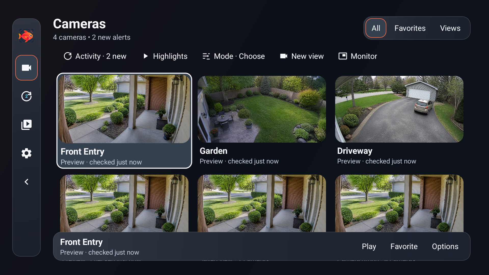
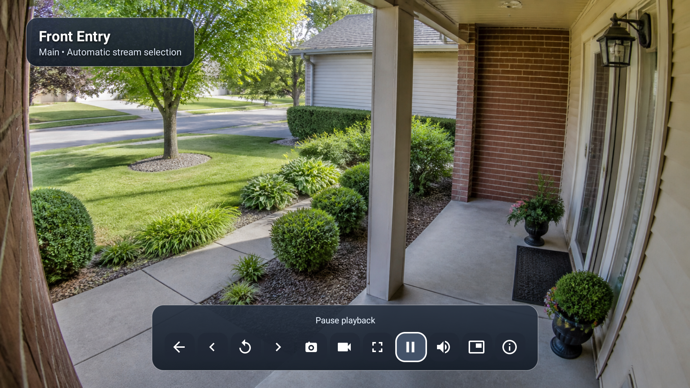
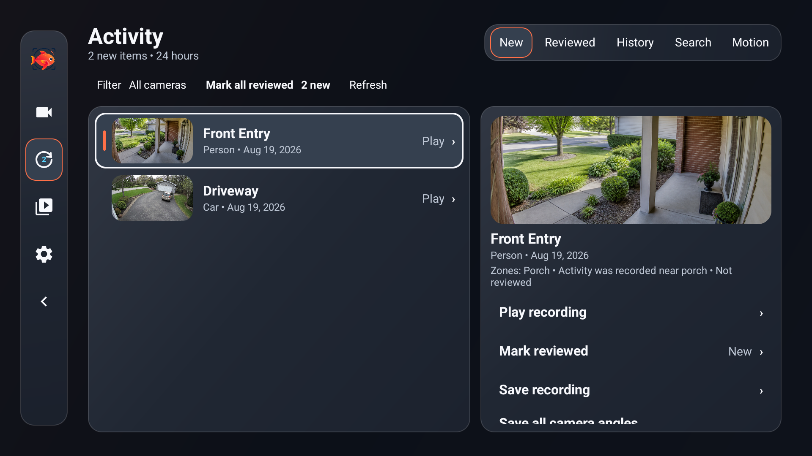
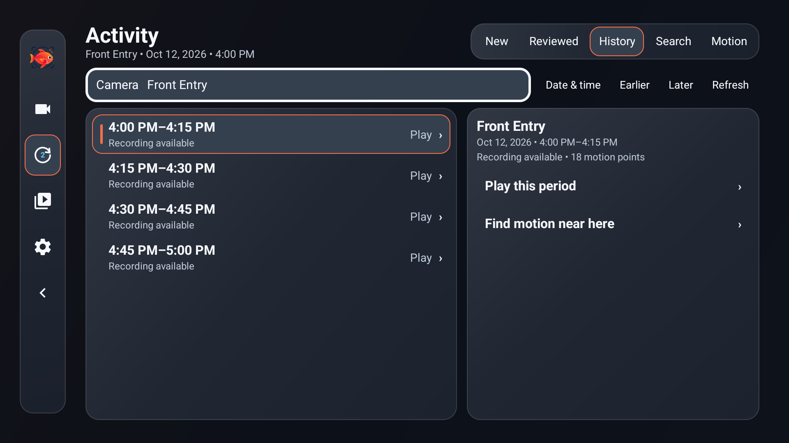

# Opah

Opah is an Android TV and Google TV app for viewing cameras and recordings from
an existing [Frigate NVR](https://frigate.video/). Designed
for a television remote, it lets you watch live cameras, use multi-camera views,
review recent activity, search saved video, browse history, and keep or share
important clips. Opah can also show calm TV alerts, watch a camera view for
important activity, and summarize what happened since you last watched.

Opah organizes everyday camera tasks into clear, approachable screens that
are comfortable to navigate from the sofa.

Opah connects directly from your TV to your Frigate server and does not operate
a separate camera cloud or recording service. It is an independent community
project and is not affiliated with, sponsored by, endorsed by, or supported by
Frigate, Inc.

## Screenshots

| Cameras | Live camera |
| --- | --- |
|  |  |

| New activity | Activity history |
| --- | --- |
|  |  |

See the [complete interface gallery](docs/screenshots.md). All camera scenes,
names, addresses, and data shown in the gallery are fictional examples.

## What you need

- A working Frigate server
- Android TV or Google TV running Android 7.0 or newer
- A Frigate username and password for the recommended authenticated connection
  (not needed for a direct port `5000` connection on a trusted private network)
- Network access from the TV to the Frigate server

Opah supports Frigate 0.17.2. Features that need Frigate 0.18 target the exact
Frigate 0.18.0 RC1 build `a745070`; its authenticated read-only API and core
TV workflows have been tested. See the [compatibility guide](docs/compatibility.md)
for camera video formats, tested devices, and troubleshooting tips.

## Install Opah

Opah is currently downloaded from GitHub rather than Google Play.

1. Download [`opah-latest.apk`](https://github.com/VibeCodingAntagonist/opah-frigate-tv-app/releases/latest/download/opah-latest.apk)
   from the newest Opah release.
2. Send that file to the TV.
3. Follow the [step-by-step installation guide](docs/installation.md).

Only download Opah from this repository. Copies from other websites may have
been changed or may be unsafe.

## Connect for the first time

For the recommended authenticated connection, Opah asks for:

1. your Frigate server address;
2. your Frigate username; and
3. your Frigate password.

Use the same secure Frigate address you normally use in a web browser when
possible. Choose the separate **Live video address** option only when live
video must use a different local host or port. Opah keeps the normal Frigate
address as the recommended default.

After a successful sign-in, Opah can securely remember the connection and sign
in automatically. Choose **Sign out** to remove the saved sign-in information.

If your TV and Frigate server share a trusted private network, Opah can also
connect directly to Frigate port `5000` without an account. Enter an address
such as `http://frigate.local:5000` and leave the username and password blank.
This connection has full Frigate access, so never expose port `5000` to the
internet. Most people should use Frigate's authenticated address instead.

## Find your way around

Opah opens on **Cameras**, with **Activity**, **Clips**, and **Settings** in the
side navigation. Move left from the edge of a page to open navigation, choose a
destination, and press the remote's center button to enter it. Back closes the
nearest dialog or returns to the previous screen.

The glass design uses compact controls, clear focus outlines, and large camera
pictures. Browsing remembers your place when you return from playback. If you
previously chose a different startup camera or view, Opah keeps that choice.

## Make Cameras yours and watch cameras together

The **Cameras** grid shows periodically refreshed previews. Open a tile to
watch live video. Preview age and failure messages help distinguish an older
picture from a working camera; choose **Retry preview** if a preview fails.

Press and hold the remote's center button on a camera or view to pin it as a
favorite, move a favorite earlier or later, or hide a camera from the grid.
Choose **Restore** to return to the default camera layout.

To make a multi-camera view, choose **New view**, select two to four cameras,
and choose **Next: name this view**. Enter a name and choose **Save view**.
**Back to cameras** lets you revise the selection without losing the name.
Saved views stay on that device and appear alongside camera groups already
set up in Frigate. Open a view to watch its cameras together. If a Frigate group
has more than four cameras, Opah asks which ones to watch.

On supported TVs, a two-camera group can also pop out over another app. Camera
names and playback controls hide while you watch; press the center button to
show the controls again.

## Find and review activity

Open **Activity** to see alerts and other recorded activity:

- **New** shows activity that still needs review.
- **Reviewed** shows activity you have already marked reviewed.
- **History** lets you browse saved video by camera. Choose **Date & time** to
  jump to a day and hour, or use **Earlier** and **Later** for nearby hours.
- **Search** finds saved activity from a short description when search is set
  up in Frigate.
- **Motion** appears on supported Frigate 0.18 servers and finds movement in a
  selected part of the picture.

Open an item to watch it, mark it reviewed or not reviewed, save its recording,
or find activity that looks similar. **New** offers **Mark all reviewed** for
the items currently shown, after a warning. The selected item stays marked
while you move into its actions. Choose **Load more activity** at the end of the list
to reach older items. Frigate may provide a short summary, a recognized name,
or a license plate.

Open **Filter** > **Review all new activity** to review the current new items
as a queue. Its heading shows which queue you are in. If saving a clip or
marking an item fails, Opah shows the problem beside that action and offers a
retry.

While a saved Activity video is playing, choose **Next activity** to continue
through the New or Reviewed list you opened, without returning to the browser.
In a review queue, it stays within that queue. At the end, the control shows
**Caught up** for a review queue or **No next activity** for ordinary browsing.
Move focus to the playback timeline and use left or right to move by 10 seconds.
Back hides visible playback controls first. Pressing Back while the controls
are hidden returns to the selected item, filters, and position in the Activity
list. Camera views and Monitor use the same hide-first behavior.

## Stay aware without watching constantly

Three optional features help you keep up with activity:

- **TV alerts** can notify you about important Frigate activity while another
  TV app is open. You choose the cameras, kinds of activity, quiet times, and
  how much detail a notification may show.
- **Monitor** on Cameras watches several cameras and can bring one active
  camera forward when something important happens. You can also start it from
  a saved view or Frigate camera group. Audio is off unless you turn it on.
  Its timer offers **Never**, **30**, **60**, or **120 minutes**.
- **Highlights** on Cameras shows a short briefing when there is unseen
  activity. Choose **Play highlights**, **Review as a list**, or dismiss only
  the summary currently shown.

Shared TVs can use a local PIN to protect selected app areas, administrative
actions, destructive actions, and private cameras. For the strongest
protection, also use a restricted Frigate account for the TV.

## Save important recordings

Choose **Save recording** while reviewing recorded activity. You can also keep a
selected part of **History**. Open **Clips** to see preview pictures, play a
clip, or share a local copy. Frigate administrators can also rename a clip or
delete it after a confirmation warning.

With a supported Frigate 0.18 server, **Save all camera angles** keeps the same moment
from several authorized cameras. Frigate administrators can group clips into
simple **Incidents**.

Clips remain on the Frigate server. They are not copied into a
separate Opah cloud service or stored as a second recording archive on the TV.

## Control and size cameras

If Frigate reports compatible camera controls, press and hold the camera tile
on **Cameras** and choose **Camera controls**. In control mode, the D-pad moves
the camera, center stops it, and a compact shelf contains supported zoom,
focus, and saved positions.

While watching a camera or Birdseye, use the screen-size control to choose
whether the whole picture fits on the television or fills the screen. Opah
remembers that choice for each camera and for Birdseye on the device. If an
audio track prevents playback, try **Settings** > **Cameras and Playback** >
**Check camera compatibility** and choose a video-only option.

## Adjust appearance and settings

Settings keeps its categories on the left and the selected page on the right.
Press right or the center button on a category to open it. Server information,
storage, appearance, and device details have their own layouts and scroll when
more information is available.

Open **Settings** > **Appearance** to choose **System**, **Dark**, **Light**, or
**Custom**. Custom mode lets you adjust the accent and background while seeing
a preview. **High contrast**, **Reduce motion**, and **Reduce transparency**
offer simpler, more readable presentation. Rounded corners are part of the
design; **Extra rounding** is an optional softer treatment.

Updating Opah keeps your saved appearance and startup choices.

## Get updates

Opah normally checks the official GitHub release page shortly after it starts.
A small dot inside the Settings gear means an update is available. Open
**Settings** > **Update** to read the release notes, download the verified APK,
and open Android's installer. You can turn automatic checks off on the same
page. Opah never downloads or installs an update without your action.

## Optional camera shortcuts

Some Android TV button-mapping and home-automation apps can send Android
commands. They can use this command to open a chosen camera directly:

```text
am start -a android.intent.action.VIEW -d "opah://live/front_door" app.opah.tv/.MainActivity
```

Replace `front_door` with the camera's exact name in Frigate. Capital letters
and underscores must match. Opah must already have a saved, working connection,
and it will open only cameras available to that Frigate account.

Home Assistant's Android TV ADB integration can send the same `am start`
command with its `androidtv.adb_command` action. A button-mapping app can call a
Home Assistant webhook, which then sends the command to the TV.

Tools that use an Android extra instead of a link can use this equivalent
command:

```text
am start -n app.opah.tv/.MainActivity --es camera "front_door"
```

## Important limitations

- Opah needs an existing Frigate server; it does not record cameras by itself.
- Camera audio plays from the TV, but speaking through a camera or doorbell is
  not supported.
- Picture-in-picture depends on support from the TV and Android version.
- Camera groups are muted and use lower-bandwidth streams when available. Some
  TVs may not be able to play four cameras at once.
- PTZ camera controls depend on support from Frigate and the camera.
- TV alerts depend on Android notification and background-service settings.
  A TV may delay alerts or restart after reboot when Android restricts the app.
- Monitor Mode depends on the TV's video hardware. Opah promotes only one live
  camera at a time, but long-running behavior still varies by device.
- Update downloads and installation are manual. Automatic availability checks
  can be turned off in Settings.

## Privacy and safety

- Your Frigate password and saved sign-in are encrypted on the device.
- Opah does not send camera data through an Opah cloud service.
- Opah does not keep its own archive of camera recordings.
- Local PIN and private-camera settings stay on the TV and do not change
  Frigate accounts or permissions.
- Alert rules and briefing progress are stored without camera images or a copy
  of your recordings.
- The Diagnostic data page is designed to leave out passwords, private addresses,
  and camera images.
- Use a secure `https://` Frigate address when one is available.
- Keep the live-video connection inside your trusted home or business network.

Read [Privacy and security](docs/security-model.md) for a fuller explanation.
Report a security concern through GitHub's
[private reporting form](https://github.com/VibeCodingAntagonist/opah-frigate-tv-app/security/advisories/new).

## Help and feedback

When reporting a problem, include the Opah version, Frigate version, Android or Google TV device model,
and a short description of what happened. Do not post your password, server
address, camera names or images, or unedited logs.

Developers who want to build or improve Opah should start with
[CONTRIBUTING.md](CONTRIBUTING.md).

## License

Opah is available under the [Apache License 2.0](LICENSE). Release history is in
[CHANGELOG.md](CHANGELOG.md).

Frigate and Frigate NVR are trademarks of Frigate, Inc. Opah uses those names
only to explain what the app works with.
